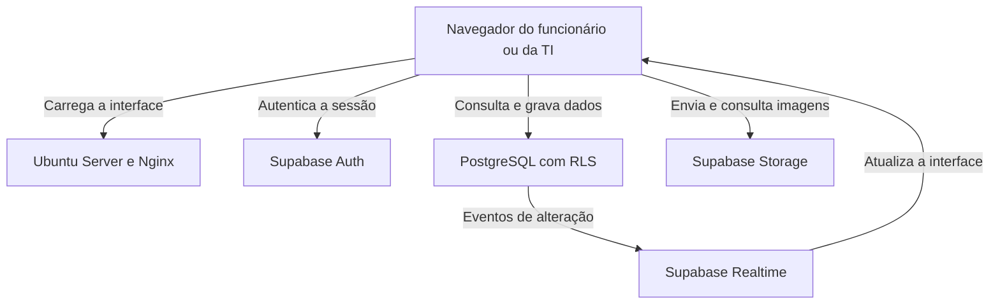

# Arquitetura

As telas foram construídas com HTML, CSS e JavaScript. O Nginx, em uma VM com Ubuntu Server, entrega esses arquivos ao navegador. A partir daí, a aplicação usa o Supabase para autenticação, dados, imagens e atualização em tempo real.

O acesso aos dados e aos arquivos é feito pelas APIs do Supabase, usando a sessão do usuário autenticado.

## Organização dos dados

| Tabela | Conteúdo |
| --- | --- |
| `profiles` | Perfil, setor e papel de acesso do usuário |
| `tickets` | Dados da solicitação, prioridade, status, responsável e solução |
| `ticket_messages` | Conversas vinculadas a cada chamado |
| `ticket_attachments` | Referências às imagens enviadas na abertura ou nas mensagens |
| `ticket_history` | Eventos e alterações do atendimento |
| `ticket_notifications` | Avisos destinados aos usuários e registro de leitura |

As imagens ficam no bucket privado `ticket-attachments`. O banco guarda as referências necessárias para associá-las ao chamado ou à mensagem.

## Permissões e gravações

O login é validado pelo Supabase Auth. Depois, o perfil determina qual área da aplicação será exibida. As políticas RLS também verificam o acesso aos registros no banco.

As respostas usam a função `send_ticket_reply`. As alterações do atendimento usam `update_ticket_as_admin`, que confere a sessão e os campos enviados.

Na alteração de um chamado, a aplicação envia a data `updated_at` que recebeu na consulta. Se o registro já foi modificado, a operação é recusada e a tela orienta o usuário a consultar a versão atual antes de salvar novamente.

## Publicação

O front-end é servido por HTTPS no ambiente interno da empresa. O Supabase mantém os serviços de autenticação, banco de dados, armazenamento e Realtime.

[Voltar à apresentação](../README.md)
